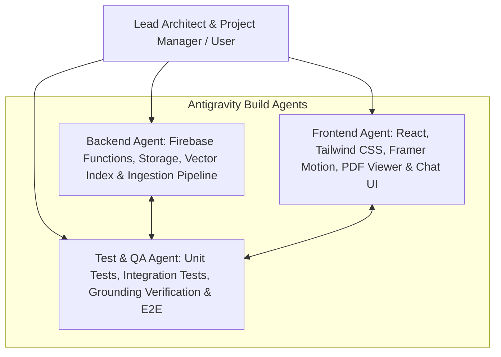
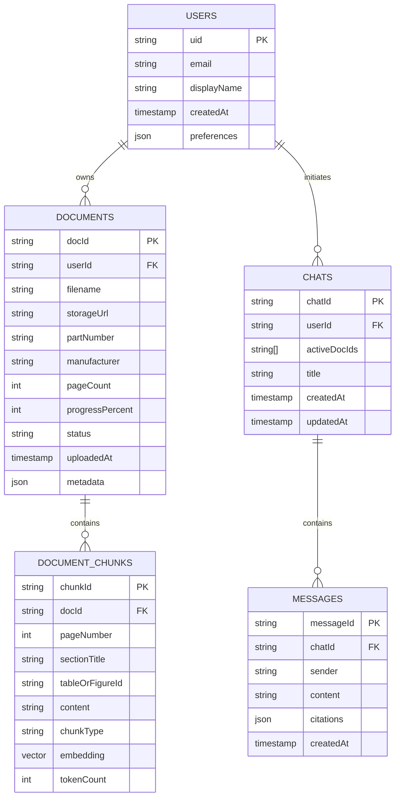

# SpecFlow — System Architecture & Database Specification

**Project:** SpecFlow ("Talk to Your Components")  
**Purpose:** Technical RAG Hardware Datasheet Intelligence Platform  
**Target User:** Hardware, Embedded, Electronics, and Systems Engineers  
**Core Value Proposition:** Eliminate manual skimming of 500-page semiconductor & hardware datasheets. Cross-reference specs, verify pinouts and thermal/electrical operating limits, and cite exact page numbers and tables with high speed and zero hallucination.

---

## 1. Antigravity Development Agents & Build Strategy

To build SpecFlow efficiently and modularly, we leverage Antigravity's multi-agent workflow during development:



*   **Backend Developer Agent:** Builds Cloud Functions for PDF parsing, text extraction, chunking, Firestore Vector Search indexing, and the runtime RAG endpoint.
*   **Frontend Developer Agent:** Builds Vite + React dashboard, dark-mode engineering UI, interactive split-pane PDF & citation viewer, and chat console.
*   **Testing & QA Agent:** Verifies vector search accuracy, tests edge cases (e.g. malformed PDFs, table layouts), tests grounding verification step, and writes unit/e2e tests.

---

## 2. In-App Runtime Architecture (Streamlined Pipeline)

Inside the application itself, we keep runtime execution fast, predictable, and cost-effective using a **single streamlined pipeline** (Retrieve -> Answer), with an optional Grounding/Fact-Check step:

```mermaid
sequenceDiagram
    autonumber
    actor Engineer as Engineer (User)
    participant UI as SpecFlow Dashboard
    participant Backend as Firebase Cloud Function (api/chat)
    participant Firestore as Firestore Vector Store
    participant LLM as Reasoning Model (Gemini 1.5 Pro / Flash)

    Engineer->>UI: Query: "Compare ADC resolution and operating voltage for STM32F401 and ESP32-S3"
    UI->>Backend: Send { query, activeDocIds: ["doc_stm32", "doc_esp32"] }
    
    rect rgb(24, 28, 36)
        Note over Backend,Firestore: STEP 1: BALANCED RETRIEVAL (MULTI-CHIP SAFE)
        Backend->>Backend: Generate query embedding (text-embedding-004)
        Backend->>Firestore: Vector Search (Cosine Similarity) Top K/2 for doc_stm32
        Backend->>Firestore: Vector Search (Cosine Similarity) Top K/2 for doc_esp32
        Firestore-->>Backend: Balanced Relevant Chunks (with pageNumber, tableMarkdown & tableId)
    end

    rect rgb(30, 36, 48)
        Note over Backend,LLM: STEP 2: GROUNDED ANSWER & CITATION GENERATION
        Backend->>LLM: Prompt with query + retrieved chunks & exact page metadata
        LLM-->>Backend: Comparative Table + Coded Citations [1], [2] with exact page & table tags
    end

    rect rgb(24, 28, 36)
        Note over Backend,LLM: STEP 3 (OPTIONAL): GROUNDING VERIFICATION
        Backend->>LLM: Quick verification check: "Do numbers & units in draft exist in chunks?"
        LLM-->>Backend: Grounding Confirmation / Flagged discrepancies
    end

    Backend-->>UI: Verified Response with exact Page Numbers & Table References
    UI-->>Engineer: Render answer with interactive clickable citation badges (Jump to PDF Page)
```



### In-App Pipeline Steps:
1. **Balanced Retrieval (Vector & Metadata Search):**
   - Embeds user query using Google `text-embedding-004` (or OpenAI `text-embedding-3-small`).
   - Executes Firestore Vector Search pre-filtered to the user's selected active datasheets.
   - For multi-chip comparative queries, partitions retrieval equally across active datasheets to prevent single-document dominance.
2. **Answer (Direct Grounded Generation):**
   - Feeds the exact context chunks (including Markdown-formatted tables) to the reasoning model.
   - Enforces strict zero-hallucination prompting: only answer from provided text; require bracketed citations `[Page X, Table Y]`.
3. **Grounding Verification (Optional Quality Guard):**
   - Performs a single lightweight verification pass to guarantee numerical values (voltages, current limits, frequencies, pin numbers) are faithful to the source chunks before UI rendering.

---

## 3. High-Reliability Datasheet Ingestion Engine

Hardware datasheets present two unique engineering challenges: **dense multi-column tables** and **massive document lengths (100–500+ pages)**. The ingestion engine incorporates two production safeguards:

### 3.1 Table-Aware Chunking (Markdown Extraction)
*   **The Rule:** Tabular data (Absolute Maximum Ratings, DC Electrical Characteristics, Pin Alternate Functions) must never be split across chunk boundaries.
*   **Format:** Tables are converted to clean Markdown tables preserving headers (`Parameter | Min | Typ | Max | Unit | Test Conditions`).
*   **Metadata Enrichment:** Every chunk carries:
    - `pageNumber`: Exact physical page number in the PDF.
    - `sectionTitle`: Header hierarchy (e.g., `6.3.2 Operating conditions`).
    - `tableOrFigureId`: Explicit identifier if present (e.g., `Table 14: General operating conditions`).
    - `chunkType`: `'table' | 'pinout' | 'prose' | 'register'`.

### 3.2 Asynchronous Batched Ingestion & Progress Tracking
*   To prevent Firebase Cloud Function execution timeouts (60s–540s limits) on 500-page PDFs:
    1. Direct upload from frontend to **Firebase Storage** (`datasheets/{userId}/{docId}.pdf`).
    2. Cloud Function event trigger processes pages in batches of 25–50 pages.
    3. Status and progress percent are written in real-time to Firestore:
       - `status: 'uploading' | 'processing' | 'indexed' | 'failed'`
       - `progress: 0% -> 45% -> 80% -> 100%`
    4. Frontend renders an engineering-grade live progress bar.

---

## 4. Complete Tech Stack Breakdown

| Layer | Technology | Purpose |
| :--- | :--- | :--- |
| **Frontend Framework** | **React (Vite)** | High performance, modular component architecture |
| **Styling & Theme** | **Tailwind CSS + Monospace Fonts** | High-contrast engineering dark mode |
| **UI Motion & Transitions**| **Framer Motion** | Smooth drawer transitions, citation pulse highlights |
| **Icons** | **Lucide React** | Clean, minimalist technical iconography |
| **PDF Rendering** | **React-PDF / PDF.js** | Split-pane PDF viewing with direct page-jump capability |
| **Backend & Ingestion** | **Firebase Cloud Functions (2nd Gen)** | Serverless RAG execution, batched PDF ingestion & chunking |
| **Auth & Storage** | **Firebase Auth & Storage** | User access & raw PDF datasheet storage |
| **Database & Vector Search** | **Cloud Firestore** | Document metadata + native Firestore Vector Search |
| **Embeddings** | **`text-embedding-004` / `text-embedding-3-small`** | 768 / 1536-dimension embeddings for dense technical specs |
| **Reasoning Model** | **Gemini 1.5 Pro / Flash** | High accuracy, large context window, fast technical reasoning |
| **Antigravity Build Team** | **3 Build Agents (Backend, Frontend, Tests)** | Concurrent, modular implementation via Antigravity Manager |

---

## 5. Firestore Database Schema



### Detailed Collection Schemas

#### 1. `users` Collection
*Path:* `/users/{userId}`
```typescript
interface UserProfile {
  uid: string;
  email: string;
  displayName: string;
  role: 'engineer' | 'admin';
  createdAt: FirebaseFirestore.Timestamp;
  preferences: {
    theme: 'dark' | 'system';
    strictness: 'high' | 'normal';
  };
}
```

#### 2. `documents` Collection
*Path:* `/documents/{docId}`
```typescript
interface DatasheetDocument {
  docId: string;
  userId: string;
  filename: string;
  storagePath: string; // gs://bucket/datasheets/{docId}.pdf
  downloadUrl: string;
  partNumber: string; // e.g. "STM32F401RE"
  manufacturer: string; // e.g. "STMicroelectronics"
  fileSizeBytes: number;
  pageCount: number;
  status: 'uploading' | 'processing' | 'indexed' | 'failed';
  progressPercent: number; // 0 to 100 for live progress bar
  errorMessage?: string;
  uploadedAt: FirebaseFirestore.Timestamp;
  metadata?: {
    packageType?: string;
    description?: string;
    tablesFound?: number;
  };
}
```

#### 3. `documents/{docId}/chunks` Subcollection
*Path:* `/documents/{docId}/chunks/{chunkId}`
```typescript
interface DocumentChunk {
  chunkId: string;
  docId: string;
  userId: string;
  pageNumber: number; // 1-indexed page in PDF
  sectionTitle: string; // e.g. "6.3.2 General Operating Conditions"
  tableOrFigureId?: string; // e.g. "Table 24"
  content: string; // Markdown table or technical text
  chunkType: 'table' | 'pinout' | 'prose' | 'register';
  embedding: FirebaseFirestore.VectorValue; // Vector Search index
  tokenCount: number;
  indexedAt: FirebaseFirestore.Timestamp;
}
```

#### 4. `chats` Collection
*Path:* `/chats/{chatId}`
```typescript
interface ChatSession {
  chatId: string;
  userId: string;
  title: string;
  activeDocIds: string[]; // Active datasheets for this query context
  createdAt: FirebaseFirestore.Timestamp;
  updatedAt: FirebaseFirestore.Timestamp;
}
```

#### 5. `chats/{chatId}/messages` Subcollection
*Path:* `/chats/{chatId}/messages/{messageId}`
```typescript
interface ChatMessage {
  messageId: string;
  chatId: string;
  sender: 'user' | 'assistant';
  content: string;
  timestamp: FirebaseFirestore.Timestamp;
  citations?: Array<{
    citationIndex: number; // e.g. [1], [2]
    docId: string;
    partNumber: string;
    pageNumber: number;
    tableOrFigure?: string;
    snippet: string;
  }>;
  groundingScore?: number; // Verified score from grounding check
}
```

---

## 6. Execution Phases Roadmap

| Phase | Title | Key Deliverable | Status |
| :--- | :--- | :--- | :--- |
| **Phase 1** | **Master Plan & Architecture** | `specflow-architecture.md` (Updated with ingestion & table preservation) | **Approved** |
| **Phase 2** | **UI/UX Design Approval** | Text-based wireframe/ASCII layout of dashboard | **Current Phase** |
| **Phase 3** | **Frontend Scaffolding** | React + Tailwind + Framer Motion UI + Git push | Awaiting Phase 2 |
| **Phase 4** | **Firebase Configuration** | Firebase Console setup, Storage, Firestore & keys | Awaiting Phase 3 |
| **Phase 5** | **RAG Backend (Cloud Functions)**| Batched ingestion, Firestore vector search, Retrieve -> Answer pipeline | Awaiting Phase 4 |
| **Phase 6** | **Integration & Final Testing** | E2E connection, citations, error states | Awaiting Phase 5 |
| **Phase 7** | **Hosting & Domain Setup** | Firebase Hosting deployment & custom domain | Awaiting Phase 6 |
